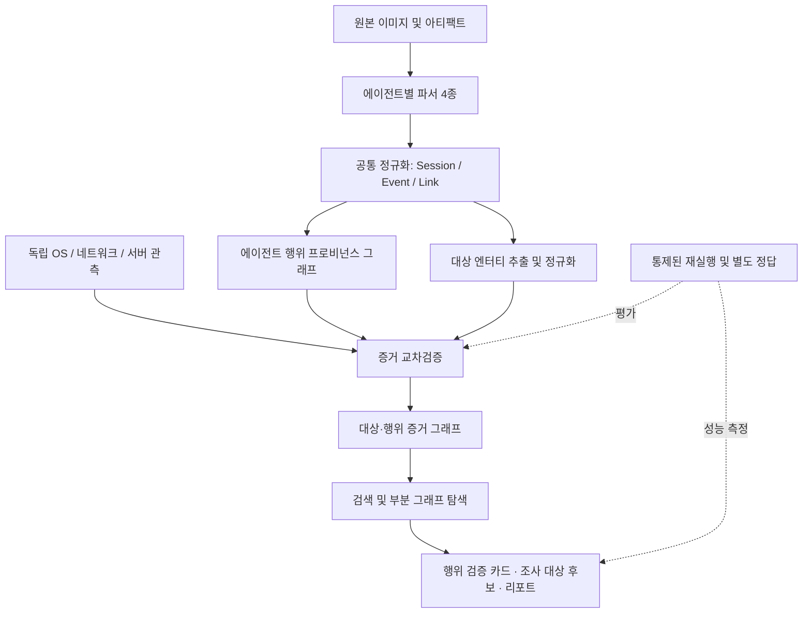

# AI Agent Forensics

이 저장소는 Codex, Cursor, Claude Code, Antigravity 등 AI 코딩 에이전트가 남긴 아티팩트를 분석해 행위를 복원하고, 에이전트 기록과 독립적인 OS·네트워크 관측을 교차검증하며, 증거 관계를 통해 **조사 대상 후보**를 발굴하기 위한 프로젝트입니다.

> **핵심 연구 질문**  
> 동일한 증거에서 프로비넌스 그래프와 관계 기반 교차검증을 사용하면, 문자열·IOC 추출 또는 정규화 이벤트 단독 검색보다 증거로 뒷받침되는 조사 대상 후보와 행위 관계를 더 정확하게 복원할 수 있는가?

이 프로젝트는 피해를 자동으로 확정하는 시스템이 아닙니다. 후보와 관계를 근거·불확실성·반대 증거와 함께 제시해 조사관의 후속 검토를 지원합니다.

## 전체 흐름



## 주요 기능

- 이기종 AI 코딩 에이전트의 원본 아티팩트 파싱 및 공통 이벤트 정규화
- 원본 파일·레코드와 정규화 이벤트 간 추적 관계 보존
- 에이전트 기록과 독립적인 OS·네트워크·서버 관측의 분리 및 교차검증
- 도메인·IP·URL·호스트명 후보 추출과 근거 기반 엔터티 해소
- 행위·대상 간 프로비넌스 관계 구성 및 관계별 근거·모순 기록
- 조사 대상 후보 카드와 원본 증거 경로 제공
- 통제된 테스트 시나리오를 이용한 대상·엣지 복원 성능 평가

## 저장소 구조

```text
.
├── README.md
├── pyproject.toml
├── .env.example
├── configs/                  # 향후 규칙 설정을 외부화하기 위한 설정 초안
├── docs/                     # 설계·스키마·증거 모델·평가 계획
├── src/
│   ├── cli.py                # 기존 CLI 진입점
│   ├── pipeline.py           # 기존 분석 파이프라인 조정
│   ├── parsers/              # 에이전트별 파서 4종 및 보조 파서
│   ├── normalization/        # Session / Event / Link 공통 정규화
│   ├── provenance/           # 에이전트 실행 과정의 프로비넌스 표현
│   ├── investigation/        # 대상 엔터티·독립 관측·조사 후보 분석
│   ├── evaluation/           # 기존 평가 인터페이스 및 일부 실험
│   ├── reporting/             # HTML 리포트 생성
│   ├── llm/                   # LLM 인터페이스와 입력 payload
│   ├── mitre/                 # MITRE 매핑
│   └── rewinding/              # 기존 리와인딩 관련 기능
├── tests/                    # 단위·통합·회귀 테스트
├── experiments/              # 통제 실험 하네스·오라클·비교군·지표 (개발 예정 포함)
├── scripts/                  # 보조 실행 스크립트
├── data/                     # 사례·추출·파싱·평가 데이터 (Git 제외)
└── runs/                     # 실행 로그·리포트·지표 (Git 제외)
```

**구조 원칙:** 기존 실행 코드가 있는 `src/`를 현재의 기준 패키지로 사용합니다. 동일한 역할의 빈 패키지를 별도로 만들지 않습니다. `src/provenance/`와 `src/investigation/graph.py`는 목적이 다른 그래프 표현이므로 아래 문서에서 역할을 구분합니다.

## 실행 방법

Python 3.11 이상을 권장합니다. 프로젝트 루트에서 실행합니다.

```bash
python src/cli.py --help
```

예시:

```bash
python src/cli.py \
  --cursor-root "/path/to/cursor-artifacts" \
  --codex-home "/path/to/user-home" \
  --observations "/path/to/observations.jsonl" \
  --output "./output"
```

Windows PowerShell에서도 `python src/cli.py --help`로 지원 옵션을 확인한 뒤 실제 증거 경로를 전달합니다. 각 에이전트의 경로와 옵션 의미는 [사용법](docs/usage.md)을 참고하세요.

현재 CLI의 `--observations`는 독립 관측 자료를 JSON·JSONL로 제공하는 입력 경로입니다. 이 입력을 이용한 모든 관계가 자동으로 확정되는 것은 아니며, 출처·수집 상태·이벤트 연관성에 따라 판단해야 합니다.

## 현재 구현과 계획의 구분

| 영역 | 현재 저장소 기준 | 설계 방향 |
|---|---|---|
| 에이전트 파싱·정규화 | 기존 모듈 존재 | 기존 코드 유지, 공통 계약과 회귀 테스트 강화 |
| 실행 프로비넌스 그래프 | `src/provenance/` 구현 존재 | 근거·규칙·모순 정보를 조사 계층과 연결 |
| 조사 대상 후보 | `src/investigation/` 기본 구현 존재 | 엔터티 해소 및 독립 관측 검증 강화 |
| 실험 1a·1b | 기본 평가 인터페이스 존재 | 정답 데이터와 독립 관측을 갖춘 평가로 보완 |
| 실험 2~4 및 하네스 | 설계·스캐폴딩 단계 | 관계 복원, 추론 엣지, Markdown/DB 비교 구현 |
| 별도 `src/agent_forensics/` 패키지 | 사용하지 않음 | 기존 소스와 중복되는 빈 패키지를 두지 않음 |

설계상 예정된 기능과 실제 구현 완료 여부는 구분합니다. 상세 상태와 우선순위는 [프로젝트 설계](docs/DESIGN.md), [레포지토리 안내](docs/repository_guide.md), [평가 계획](docs/evaluation_plan.md)을 참고하세요.

## Cursor 프로비넌스 그래프 1차 실험

Cursor 파서의 원본 `links`를 보존하고 메시지·도구 호출·결과·대상 엔터티를 연결하는 별도 실험 모듈을 추가했습니다. 이 기능은 아직 기본 `run_pipeline()`에 자동 연결되지 않은 검토용 첫 단계입니다.

- 설계 및 업로드 자료 실측: [Cursor 프로비넌스 1차 설계](docs/cursor_provenance_first_pass.md)
- 그래프 생성기: `src/provenance/cursor_evidence_graph.py`
- Cursor 관계 규칙: `configs/graph/cursor_edge_rules.yaml`
- 대상 추출 규칙: `configs/entities/cursor_target_rules.yaml`
- 안전한 구조 미리보기: `data/samples/cursor_provenance_graph_preview.json` (ID·엔터티 값·원본 참조 비식별화)

압축 해제한 Cursor 아티팩트의 루트 경로를 지정해 실행할 수 있습니다. 원본 기록과 개인 경로를 포함할 수 있으므로 기본 출력은 공유하지 말고, 구조 검토용 결과를 공유할 때는 `--safe-preview`를 사용하세요.

```bash
python scripts/build_cursor_evidence_graph.py \
  --root /path/to/extracted-cursor-artifacts \
  --output runs/cursor/evidence_graph_preview.json \
  --safe-preview
```

## 주요 문서

- [전체 설계 및 8주 일정](docs/DESIGN.md)
- [아키텍처와 모듈 책임](docs/architecture.md)
- [레포지토리 안내](docs/repository_guide.md)
- [아티팩트 카탈로그](docs/artifact_catalog.md)
- [기존 Session / Event / Link 계약](docs/canonical_schema.md)
- [증거 모델과 상태](docs/evidence_model.md)
- [엣지 생성·확정 규칙](docs/edge_rules.md)
- [엔터티 해소](docs/entity_resolution.md)
- [질의 파이프라인](docs/query_pipeline.md)
- [평가 계획](docs/evaluation_plan.md)
- [타당성 위협과 한계](docs/threat_to_validity.md)
- [실행 방법](docs/usage.md)

## 연구 범위와 유의점

- 핵심 평가 대상은 도메인·IP·URL·호스트명이며, 파일 경로는 행위 그래프의 자원으로 사용합니다.
- 계정·조직·클라우드 리소스의 광범위한 엔터티 해소와 실시간 OSINT 연동은 이번 2개월 범위에서 제외합니다.
- LLM은 근거 패킷의 설명과 요약을 지원할 수 있지만 인과관계나 피해 여부를 독자적으로 확정하지 않습니다.
- 재실행은 통제된 실험에서 규칙의 성능을 평가하기 위한 것이며, 실제 조사 대상 장비의 행위를 재실행하는 절차가 아닙니다.
- 피해 또는 침해를 확정하려면 대상 시스템의 기록이나 영향에 대한 별도 증거가 필요합니다.
