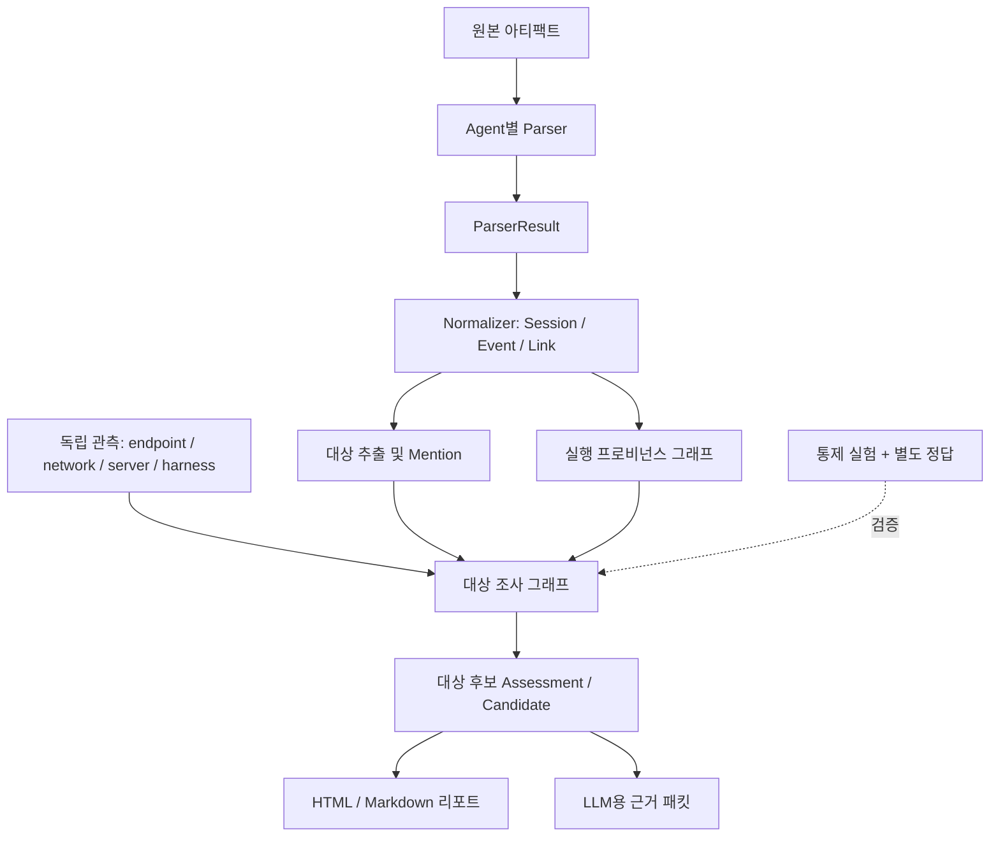

# Architecture

## 1. 논리 아키텍처

## 2. 처리 단계

1. **증거 확보:** 입력 경로, 출처, 해시 및 수집 범위를 기록한다.
2. **파싱:** 각 에이전트 전용 파서가 원본 구조를 해석한다.
3. **정규화:** 이벤트를 기존 `Session / Event / Link` 계약으로 정리하면서 원본 필드와 참조를 보존한다.
4. **실행 프로비넌스 구성:** `src/provenance/`가 메시지·도구·실행 단계의 증거/실행 노드와 관계를 표현한다.
5. **대상 조사 그래프 구성:** `src/investigation/`가 엔터티 언급, 독립 관측, 대상 관계, 충돌 및 후보 점수를 표현한다.
6. **질의 및 결과 출력:** 관련 이벤트와 그래프를 검색해 카드·리포트를 만든다.
7. **별도 평가:** 통제된 시나리오와 독립적인 정답으로 관계와 후보 발굴 성능을 평가한다.

## 3. 두 그래프의 역할 구분

저장소에는 목적이 다른 두 그래프 표현이 있다. 이를 하나의 구현이라고 혼동하지 않는다.

| 모듈 | 책임 | 주요 데이터 |
|---|---|---|
| `src/provenance/` | 에이전트 실행 과정에서 증거 단위와 실행 단위 사이의 관계를 표현 | `EvidenceNode`, `ExecutionNode`, `TypedEdge`, `ProvenanceGraph` |
| `src/investigation/graph.py` | 이벤트·엔터티·독립 관측 사이의 대상 조사 관계를 표현 | `Entity`, `Mention`, `Observation`, `Edge`, `Graph` |

두 표현은 가능한 경우 정규화 이벤트 ID와 원본 증거 참조를 통해 연결한다. 현 단계에서는 하나의 물리적 그래프 DB나 단일 공통 그래프 스키마가 이미 완성됐다고 가정하지 않는다. 리포트는 각각의 근거를 보존하면서 두 결과를 함께 제시할 수 있다.

## 4. 모듈 책임 원칙

- 파서는 에이전트별 원본 포맷을 해석한다. 공통 조사 규칙을 각 파서에 중복 구현하지 않는다.
- 정규화 모듈은 필드와 이벤트 의미를 통일한다. 독립 실행 사실을 추론하지 않는다.
- 프로비넌스/조사 계층은 관계를 생성하되 증거와 규칙을 기록한다.
- LLM은 근거를 설명하거나 요약할 수 있지만, 근거가 없는 관계를 확정하지 않는다.
- 평가 오라클은 운영 파이프라인과 분리하고, 정답을 후보 발굴 입력으로 사용하지 않는다.

## 5. 구현 상태 표기

설계된 디렉터리나 문서가 존재한다는 사실만으로 기능 구현 완료를 뜻하지 않는다. 기능 상태는 다음과 같이 표현한다.

- **구현됨:** 현재 코드에 동작 로직이 존재함.
- **부분 구현:** 기본 경로는 있으나 일부 시나리오·검증·평가가 빠져 있음.
- **계획/스캐폴딩:** 인터페이스나 파일만 있고 실제 동작은 구현되지 않음.
